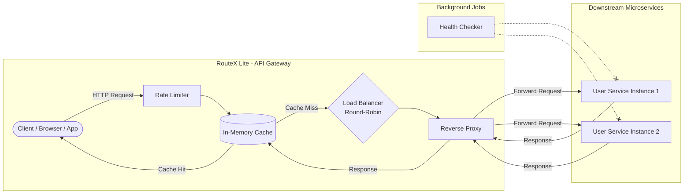

# RouteX Lite — Interview Preparation Guide

This document is designed to help you explain the RouteX Lite project in a system design or backend engineering interview. It contains an architectural breakdown, a high-level design diagram, and a comprehensive list of potential interview questions with detailed answers.

## 1. How to Explain the Architecture 

When an interviewer asks you to explain the architecture, start with a **one-sentence summary** of what the system is, and then trace the **lifecycle of a request** as it flows through the system.

**The Summary:**
> "RouteX Lite is a lightweight, pure Node.js and Express-based API Gateway. It acts as a single entry point for clients, routing incoming traffic to multiple backend microservices while providing cross-cutting concerns like rate-limiting, caching, and load balancing in-memory."

**The Request Lifecycle (The Pipeline):**
Explain that the architecture follows a **Chain of Responsibility** (or Middleware Pipeline) pattern. When a client makes a request to `/api/*`, it goes through several stages:

1. **Request Logger:** The request first hits the logger middleware. This immediately records the incoming request (method, path) and attaches a timer to measure how long the whole request takes.
2. **Rate Limiter:** Next, the rate limiter checks the client's IP address against an in-memory store. If the client has exceeded the allowed requests (e.g., 10 requests per minute), the gateway immediately returns a `429 Too Many Requests` error, protecting downstream services.
3. **Cache Layer:** If the request is a `GET` request, the cache middleware checks its in-memory store (a Map or Dictionary). If a cached response exists for that URL, it returns it instantly, bypassing the downstream services entirely.
4. **Load Balancer (Round Robin):** If there is no cache, the request moves to the load balancer. Using a simple Round-Robin algorithm, it looks at the pool of registered backend services and selects the *next* available service instance (e.g., toggling between Service A and Service B).
5. **Reverse Proxy:** Finally, the proxy handler uses `node-fetch` to forward the client's original HTTP request (headers, body, query params) to the selected backend service. 
6. **Return Path:** When the backend responds, the proxy captures the response, saves it to the Cache (if it was a `GET`), logs the total completion time, and sends it back to the client.

**Background Processes:**
*   **Health Checker:** Running asynchronously in the background, a health check module periodically pings the backend services to ensure they are alive and updates the gateway's status (`HEALTHY`, `DEGRADED`, or `UNHEALTHY`).

---

## 2. High-Level Design (HLD)

If the interviewer asks you to draw this on a whiteboard, keep it clean and block-based. You want to show the separation between the **Client**, the **API Gateway**, and the **Microservices**.



---

## 3. Anticipated Interview Questions & Answers

### A. Questions on Architecture & Trade-offs (The "Why" Questions)

**Q: "Why did you choose Node.js/Express for an API Gateway instead of a compiled language like Go or Rust?"**
**Answer:** Node.js uses an event-driven, non-blocking I/O model (the event loop). An API Gateway is inherently an I/O-bound application—it spends most of its time waiting for network requests (from clients and to backend services) rather than doing heavy CPU computations. Node.js is incredibly efficient at handling thousands of concurrent I/O operations on a single thread. While Go or Rust might offer lower memory footprints and slightly better raw performance, Node.js offers a massive ecosystem (NPM), rapid development speed, and allows frontend/full-stack teams to easily contribute to the gateway code using TypeScript/JavaScript.

**Q: "You used `node-fetch` for proxying. What are the downsides of this compared to raw TCP socket piping?"**
**Answer:** `node-fetch` is a high-level HTTP client. When it proxies a request, it buffers the entire incoming HTTP request into memory, parses the headers and body, and then constructs a brand new outgoing HTTP request to the backend. When the response comes back, it does the same in reverse. This parsing and memory buffering add significant overhead (CPU and memory latency). Raw TCP socket piping (like what Nginx or HAProxy uses) simply streams the raw bytes from the incoming socket directly to the outgoing socket without parsing the entire HTTP body, which is vastly faster and handles large files (like video streaming) much better.

**Q: "If we wanted to add Authentication (like JWT validation) to this gateway, where exactly in your middleware pipeline would you put it, and why?"**
**Answer:** I would place the Authentication middleware **after the Rate Limiter** but **before the Cache and Load Balancer**.
*   *Why after the Rate Limiter?* Cryptographic operations (like verifying a JWT signature) consume CPU. If an attacker floods the gateway with invalid requests, the Rate Limiter will drop them cheaply before the CPU wastes time trying to decode fake tokens.
*   *Why before the Cache?* You don't want unauthorized users to accidentally receive sensitive data that was cached from an authorized user's request, nor do you want them bypassing auth to hit the backend via the Load Balancer.

### B. Questions on Scaling & Distributed Systems

**Q: "Your rate limiter and cache are in-memory. If we deploy 5 instances of this Gateway behind an AWS Application Load Balancer, what breaks, and how do you fix it?"**
**Answer:** The state becomes "fragmented." If the limit is 10 requests/minute, a user could hit Gateway Node A 10 times, then hit Node B 10 times, effectively bypassing the limit and getting 50 requests total across the 5 nodes. Similarly, cache hit rates will plummet because Node A doesn't know about the data Node B just cached. To fix this, I would move the state out of the individual Node.js processes and into a centralized, fast key-value store like **Redis**. All 5 gateway nodes would check and update the same Redis instance for rate limits and cache keys.

**Q: "If we use Redis for caching and rate limiting, we introduce a network hop to Redis for every incoming request. Doesn't that defeat the purpose of a fast gateway? How can we optimize this?"**
**Answer:** While a network hop to Redis (usually <1ms in the same VPC) is fast, it's still slower than local RAM. To optimize this, I would use a **Two-Tier Caching (or L1/L2 caching) strategy**. The gateway keeps a small, short-lived in-memory cache (L1, e.g., an LRU cache lasting 5-10 seconds) for the most frequently accessed data. If there's an L1 miss, it checks Redis (L2). This drastically reduces network calls to Redis for "hot" data while maintaining a distributed state for the cluster.

**Q: "How does your system handle 'Thundering Herd' problems? (e.g., A popular cache key expires, and suddenly 1,000 requests hit the backend at the exact same millisecond before the cache can repopulate)"**
**Answer:** A basic cache will just pass all 1,000 requests to the backend, potentially crashing it. I could handle this using **Stale-While-Revalidate**. If a cache key is expired (or close to expiring), the gateway immediately serves the "stale" (old) data to 999 users, but lets exactly *one* request go to the backend to fetch the fresh data. Once that single request returns, it updates the cache for everyone. Alternatively, I could use **Redis Distributed Locks** (Mutex) to ensure only one gateway node is allowed to query the backend for a missing key while the others wait a few milliseconds for the cache to populate.

### C. Questions on Load Balancing & Reliability

**Q: "You implemented Round-Robin. What are the flaws of Round-Robin, and what other algorithms could you use?"**
**Answer:** Round-Robin blindly sends traffic sequentially (Server 1, then Server 2, then Server 1...). Its major flaw is that it assumes all servers have the exact same hardware capacity and that all requests take the same amount of time. If Server 1 gets bogged down processing a heavy request, Round-Robin will still blindly hand it 50% of new traffic, making it worse.
Better algorithms include:
*   **Least Connections:** Sends the request to the server with the fewest active, in-flight requests.
*   **Weighted Round-Robin:** Allows you to assign a "weight" (e.g., send 80% to a powerful server, 20% to a weak one).
*   **Latency-Based Routing:** Sends traffic to the server that has historically responded the fastest.

**Q: "What happens right now if `user-service-1` crashes while the gateway is routing a request to it?"**
**Answer:** Currently, `node-fetch` would try to connect, fail to establish a TCP connection (Connection Refused), and throw an error. The Express `proxyHandler` would catch this error and likely return a `500 Internal Server Error` or `502 Bad Gateway` to the client. The client experiences a hard failure.

**Q: "How would you implement a 'Circuit Breaker' or 'Retry mechanism' in this gateway?"**
**Answer:**
*   **Retries:** In the `proxyHandler`, if `node-fetch` catches a network error or a 5xx response, instead of immediately failing to the client, I would catch the error, grab the *next* available server from the Load Balancer, and try the `node-fetch` call again (usually capped at 2-3 retries).
*   **Circuit Breaker:** I would wrap the proxy call in a state machine. If `user-service-1` fails 5 times in a row within a short window, the Circuit Breaker trips to the "Open" state. The load balancer temporarily removes `user-service-1` from the pool. After a timeout (e.g., 30 seconds), the circuit moves to "Half-Open", allowing *one* test request through. If it succeeds, the circuit "Closes" (recovers). If it fails, it stays "Open".

### D. Questions on the specific Middlewares

**Q: "How exactly does your Rate Limiter work? Are you using a Fixed Window, Sliding Window Log, or Token Bucket algorithm?"**
**Answer:** *(Assuming you implemented the simplest version)* "Currently, I am using a **Fixed Window** algorithm. It creates a timestamp (e.g., 10:00 AM to 10:01 AM) and counts requests for an IP. If the count exceeds the limit, it blocks them until the minute rolls over. The flaw with Fixed Window is the 'burst' problem—a user could send their maximum allowed requests at 10:00:59, and then another batch at 10:01:01, effectively doubling their allowed traffic in a 2-second span. For a production system, I would upgrade this to a **Sliding Window Log** or **Token Bucket** algorithm using Redis to smooth out the traffic."

**Q: "How does your Cache middleware handle different HTTP methods? Should it cache POST or PUT requests?"**
**Answer:** No, the gateway should **only cache `GET` requests** (and potentially `HEAD` or `OPTIONS`). `GET` requests are intended to be *idempotent* and safe (they don't change data on the server). `POST`, `PUT`, `PATCH`, and `DELETE` requests mutate data (e.g., creating a user, processing a payment). If you cached a `POST` request, the gateway would return a success message to the client without actually sending the data to the backend, resulting in massive data loss and state corruption.

**Q: "How do you handle Cache Invalidation? What if a user updates their profile on the backend, but your gateway is still serving the old cached profile?"**
**Answer:** This is one of the hardest problems in software engineering. In the current "Lite" version, I rely purely on **Time-To-Live (TTL)**. The data stays stale until the TTL expires.
In a real-world system, I would use **Event-Driven Invalidation**. When the backend service updates the profile, it would publish a message to a message broker (like RabbitMQ or Kafka) or directly to Redis Pub/Sub. The Gateway would listen for these events, and when it receives an "UpdateUser" event, it actively deletes that specific user's key from the Redis cache so the next request fetches fresh data.

### E. Coding / Whiteboard pseudo-code

**Q: "Write a quick pseudo-code for how you would implement a 'Least Connections' load balancer instead of Round Robin."**
**Answer:**
```typescript
// Keep track of active connections for each service
const activeConnections = {
  "user-service-1": 0,
  "user-service-2": 0
};

function getNextServiceLeastConnections(services) {
  // Sort services by the lowest number of active connections
  return services.sort((a, b) => activeConnections[a.id] - activeConnections[b.id])[0];
}

// In the proxy middleware:
app.use(async (req, res, next) => {
   const target = getNextServiceLeastConnections(services);
   activeConnections[target.id]++; // Increment before forwarding
   
   try {
       await proxyHandler(req, target); 
   } finally {
       activeConnections[target.id]--; // Decrement when response completes or fails
   }
});
```

**Q: "Show me how you would modify your `proxyHandler.ts` to attach a unique `X-Trace-ID` to every request so we can track it across microservices."**
**Answer:**
```typescript
import { v4 as uuidv4 } from 'uuid';

export const proxyHandler = async (req, res) => {
  // Generate a trace ID if the client didn't provide one
  const traceId = req.headers['x-trace-id'] || uuidv4();
  
  // Create new headers object to send to the backend
  const forwardHeaders = {
      ...req.headers,
      'x-trace-id': traceId // Inject the trace ID
  };
  
  // Include this in your node-fetch call
  const response = await fetch(targetUrl, {
      method: req.method,
      headers: forwardHeaders,
      body: req.body
  });
  
  // Optionally attach it to the response going back to the client
  res.setHeader('X-Trace-ID', traceId);
  // ... return response ...
};
```

**Q: "Write the logic to safely stream a very large file download (e.g., 5GB video) through your proxy without crashing Node.js with an Out-of-Memory error."**
**Answer:**
```typescript
// Instead of buffering the whole response into memory like this (BAD):
// const data = await response.buffer(); 
// res.send(data);

// You must use Streams (GOOD):
import fetch from 'node-fetch'; // (node-fetch v2)

export const proxyStreamHandler = async (req, res) => {
    const backendResponse = await fetch('http://backend/large-video.mp4');
    
    // Set headers appropriately
    res.status(backendResponse.status);
    backendResponse.headers.forEach((value, name) => res.setHeader(name, value));
    
    // Pipe the readable stream from the backend directly to the Express response writable stream.
    // This processes the data in small chunks (e.g., 64kb) and immediately garbage collects them,
    // keeping memory usage flat regardless of file size.
    backendResponse.body.pipe(res);
};
```
